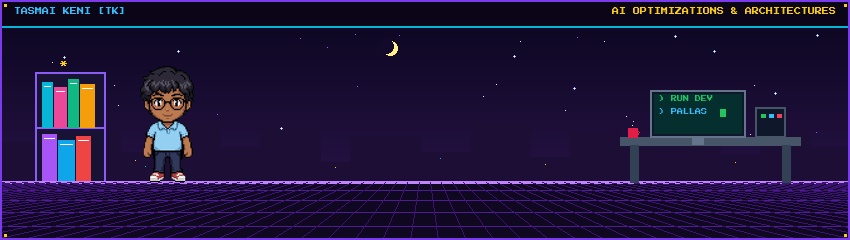
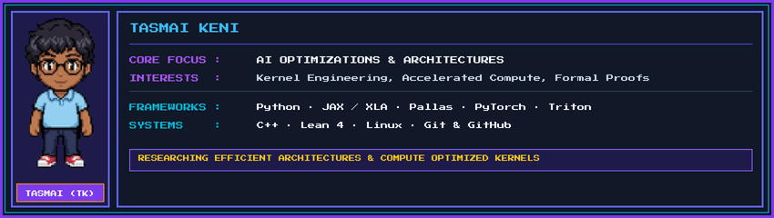
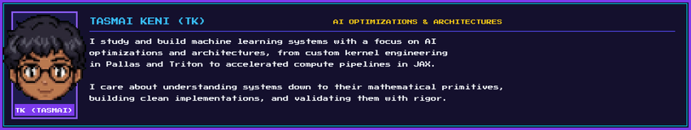
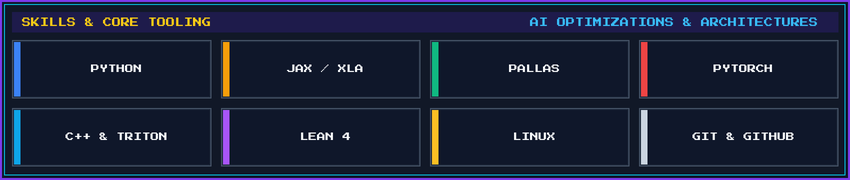
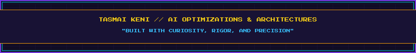

 

# Tasmai Keni (TK)

 

 

  

 

## About Me

  

 

My work centers on **AI optimizations and model architectures**, focusing on kernel engineering, accelerated compute pipelines, and verifiable systems.

I spend my time digging into how machine learning workloads run at the hardware and compiler level, writing custom kernels, and exploring how formal methods can bring mathematical rigor to neural system invariants.

 

  

 

  

 

## Skills & Tooling

  

 

 

  

 

## Projects

A selection of open source projects, formal proof implementations, and systems:

* **[Melodic Intelligence Layer](https://github.com/tasmaikeni13/Melodic-Intelligence-Layer)**: Mathematical theory of algorithmic piano composition with musical identity, built without neural networks and verified with machine checked Lean 4 proofs.
* **[VIOLET](https://github.com/tasmaikeni13/violet)**: Python electromechanical cipher machine simulator with a desktop GUI application, empirical theorem tests, and statistical cryptanalysis tools.
* **[HMV](https://github.com/tasmaikeni13/HMV)**: Experimental 1536 bit sponge hash family featuring a controller driven permutation with machine checked Lean 4 wide trail proofs.
* **[K Map Tic Tac Toe](https://github.com/tasmaikeni13/kmap-tictactoe)**: Unbeatable Tic Tac Toe AI powered entirely by Karnaugh maps and Boolean logic minimization rather than game tree search.
* **[Expression Tree Visualizer](https://github.com/tasmaikeni13/expression-tree-visualizer)**: Interactive visualization tool for expression trees that converts infix expressions to prefix or postfix and demonstrates parsing, traversal, and evaluation algorithms.

 

  

 

## Connect

  

  

